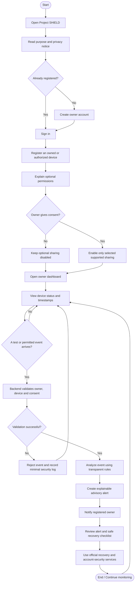
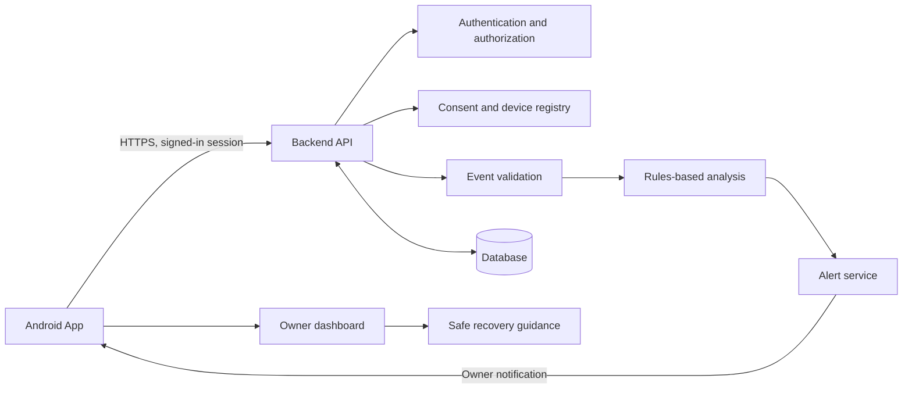

# Project SHIELD — Flowchart

The diagrams below describe the proposed workflow. They are design diagrams, not proof that the app or backend has already been implemented.

## 1. Owner / application workflow

## 2. High-level system architecture

## 3. Key decision rules
- If the owner declines optional permission, that data is not collected or uploaded.
- If the owner revokes consent, optional sharing stops.
- If the backend cannot verify account, device ownership, or consent, it rejects the event.
- Alerts are advisory and may be incorrect; the app must explain the reason and show data freshness.
- Location, if included later, is shown only when explicitly enabled by the authorized owner.
