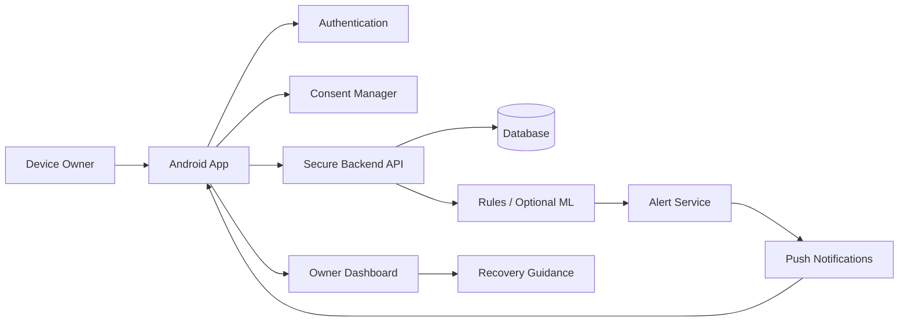
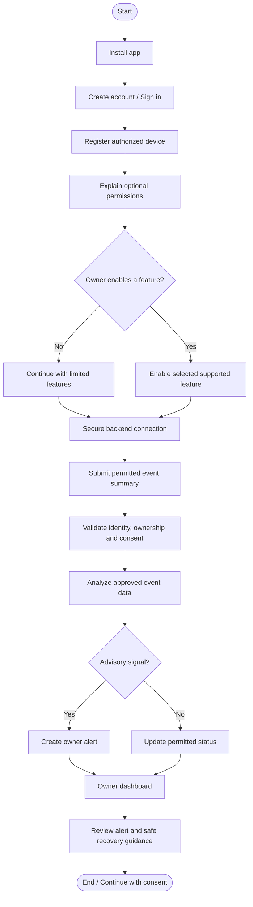

# System Architecture

## High-Level Architecture

## End-to-End Workflow

## Component Responsibilities
- **Android app:** UI, sign-in flow, consent explanations, and display of permitted data.
- **Authentication:** verifies the owner and issues a session/token.
- **Consent manager:** records optional features enabled by the owner and when.
- **Backend API:** validates identity, ownership, and consent on every request.
- **Database:** stores minimal account references, device metadata, consent state, and alerts.
- **Analysis service:** evaluates approved event summaries; begin with documented rules.
- **Notification service:** delivers owner-facing alerts.
- **Dashboard:** displays alert reasons, device status, and last-update timestamps.
- **Recovery guidance:** provides safe next steps and official support links.

## Data Flow
1. Owner signs in.
2. Backend verifies the session.
3. Owner registers an authorized device and reviews optional permissions.
4. App sends only permitted, supported event summaries over HTTPS.
5. Backend checks device ownership and consent.
6. Analysis produces an advisory result with a reason.
7. Alert is stored and delivered to the registered owner.
8. Dashboard fetches only records the signed-in owner may access.

## Design Decisions
- Select one backend approach for the first release: Firebase or Spring Boot.
- Keep analysis explainable; do not rely on an opaque model for critical decisions.
- Include timestamps and data-freshness indicators.
- Enforce authorization server-side; hiding a screen is not security.
- Separate identity, consent, device metadata, alerts, and optional location records.